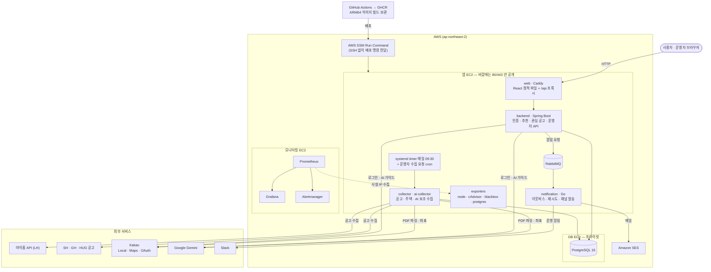

# ZIPICK (집픽)

공공임대 공급주택을 지도에서 탐색하고, 사용자 기본 정보와 희망 주거조건을 바탕으로 추천 점수·근거와 관심 공고 일정을 제공하는 서비스입니다.

| 구성 | 기술 스택 |
| --- | --- |
| Backend · 수집기 | Java 25 · Spring Boot 4.1.1 · Spring Security · JPA · PostgreSQL 16 |
| Frontend | React 18 · TypeScript · Vite · TanStack Query · Kakao Maps |
| 알림센터 | Go 1.25 · RabbitMQ 4.1 · Slack webhook · Amazon SES |
| AI | Gemini (공고 PDF 파싱·정규화 검수, AI 신청 준비 가이드) |
| 인프라 | AWS EC2(ARM64) 3대 · Docker Compose · Caddy · GitHub Actions + GHCR + AWS SSM · systemd timer |
| 모니터링 | Prometheus · Grafana · Alertmanager · node-exporter · cAdvisor · blackbox · postgres-exporter |

## 시스템 구성도



| 구성 요소 | 역할 |
| --- | --- |
| **web (Caddy)** | 빌드된 React 정적 파일을 서빙하고 `/api`·Swagger 요청을 backend 로 넘깁니다. 바깥에 열린 유일한 포트(80/443)입니다 |
| **backend** | 인증(JWT·카카오 로그인), 지도·필터, 추천(AHP), 관심 공고·일정, AI 신청 준비 가이드, 운영자 화면 API. 주변 인프라는 기동 후 자동 수집합니다 |
| **collector / ai-collector** | backend 와 같은 이미지를 배치 모드로 실행합니다. 평소엔 떠 있지 않고 systemd 타이머(매일 09:30)나 운영자 화면의 "수집 실행" 요청 때만 실행됩니다 |
| **notification (알림센터)** | 판단 없이 "보내기만" 하는 별도 Go 앱. RabbitMQ 로 받은 요청을 아웃박스에 적고 Email(SES)·Slack 으로 발송·재시도합니다 |
| **DB 서버** | PostgreSQL 16. 프라이빗 서브넷에 두고 앱 서버 보안 그룹에서만 접근합니다 |
| **모니터링 서버** | Prometheus 가 앱 서버 exporter 를 사설 IP 로 수집하고, Grafana 대시보드와 Alertmanager 경보를 제공합니다 |
| **CD** | GitHub Actions 에서 ARM64 이미지를 빌드해 GHCR 에 올리고, SSH 대신 AWS SSM 으로 서버에 배포 명령을 보냅니다. 버튼으로 실행(`workflow_dispatch`)합니다 |

## 로컬 개발 환경 실행

### 1. 준비 사항

- JDK 25, PostgreSQL, Node.js 및 npm
- Gradle 별도 설치 불필요 (`zipick-backend/gradlew` 사용)
- 실행 명령은 별도 표기가 없으면 **저장소 루트** 기준

### 2. 데이터베이스 및 스키마

PostgreSQL에 `zipick` 데이터베이스를 생성합니다.

```sql
CREATE DATABASE zipick;
```

최초 스키마 생성 시 **다음 순서를 지켜** 실행합니다.

```bash
psql -U <DB_USERNAME> -d zipick -f zipick-backend/db/local-init.sql
psql -U <DB_USERNAME> -d zipick -f zipick-backend/db/notice-init.sql
psql -U <DB_USERNAME> -d zipick -f zipick-backend/db/infra-init.sql
psql -U <DB_USERNAME> -d zipick -f zipick-backend/db/guide-init.sql
psql -U <DB_USERNAME> -d zipick -f zipick-backend/db/admin-init.sql
```

**이미 쓰던 로컬 DB에 AI 신청 준비 가이드만 추가하는 경우에는 마지막 한 줄만** 실행하면 됩니다.
`guide-init.sql`·`admin-init.sql`은 `DROP` 없이 `CREATE TABLE IF NOT EXISTS`만 쓰므로 여러 번 실행해도 기존 데이터가 지워지지 않습니다.
다른 세 파일을 다시 실행할 필요는 없습니다.

> **주의:** 위 네 파일 중 `guide-init.sql`을 제외한 세 개는 기존 테이블을 삭제하고 재생성합니다. **새 로컬 DB 초기화 전용**으로 사용하며, 배포 DB에는 실행하지 마세요. `notice-init.sql`이 공고·주택을 참조하는 관심 공고와 인프라 테이블도 먼저 삭제하므로, 반드시 위 세 파일을 순서대로 모두 실행해야 합니다. 상세 내용: [데이터베이스 설정](docs/database.md).

### 3. 환경 변수 및 API 키

백엔드 실행 전 아래 값을 환경 변수로 설정합니다. 실제 비밀번호·JWT 키는 저장소에 커밋하지 않습니다.

| 환경 변수 | 설명 | 기본값 |
| --- | --- | --- |
| `DB_USERNAME`, `DB_PASSWORD` | PostgreSQL 인증 정보 (필수) | 없음 |
| `DB_HOST`, `DB_PORT`, `DB_NAME` | DB 연결 정보 | `localhost`, `5432`, `zipick` (local) |
| `JWT_SECRET` | Base64 인코딩된 32바이트 이상의 JWT 서명 키 (필수) | 없음 |
| `NOTIFICATION_BASE_URL` | 알림센터(zipick-notification) 주소 | `http://localhost:8081` |
| `NOTIFICATION_INTERNAL_KEY` | 알림센터와 공유하는 키. 알림센터에도 같은 값 | 없음 (비우면 알림 기능 꺼짐: 설정 화면 503, 스케줄러 건너뜀) |
| `NOTIFICATION_QUEUE_ENABLED`, `RABBITMQ_HOST`, `RABBITMQ_PORT`, `RABBITMQ_USER`, `RABBITMQ_PASSWORD` | 알림 요청을 RabbitMQ 로 던질 때 | `false` (HTTP 로 보냄), `localhost`, `5672`, `guest`/`guest` |
| `APP_URL` | 알림 문구에 넣는 서비스 주소 (소식 메일의 수신 거부 안내) | `http://localhost:5173` |
| `NOTIFICATION_OPS_SLACK_WEBHOOK_URL`, `NOTIFICATION_OPS_EMAIL` | 공고 수집 일일 보고를 받을 운영 슬랙·메일. 둘 다 비우면 보고를 보내지 않는다 | 없음 |
| `GEMINI_API_KEY` | Gemini 공통 키. **AI 신청 준비 가이드·공고 PDF 파서·공고 정규화가 함께 쓰며 Google 프로젝트 quota 도 공유한다.** 비우면 AI 가이드만 꺼지고 나머지는 정상 동작 | 없음 |
| `APPLICATION_GUIDE_MODEL` | AI 가이드가 쓸 Gemini 모델 (선택). 비우면 `GEMINI_MODEL`, 그것도 없으면 기본값 | `gemini-3.5-flash-lite` |
| `GEMINI_MODEL` | **AI 가이드의 2순위 기본 모델** (선택). 다른 AI 기능에는 적용되지 않는다 | 없음 |
| `APPLICATION_GUIDE_DAILY_CALL_BUDGET` | AI 가이드가 하루에 허용하는 생성 호출 수 (선택). 비우면 기본값, `0`이면 제한 없음 | `200` |

JWT 키 생성 예시 (macOS / Linux / WSL):

```bash
openssl rand -base64 32 | tr -d '\n'
```

외부 API 키는 `zipick-backend/config/application-secret.example.yml`을 복사한 `zipick-backend/config/application-secret.yml`에 입력합니다.

```yaml
myhome:
  api:
    service-key: "<YOUR_DATA_GO_KR_DECODING_KEY>"
kakao:
  local:
    rest-api-key: "<YOUR_KAKAO_REST_API_KEY>"
# AI 신청 준비 가이드. 환경 변수 GEMINI_API_KEY 를 쓰면 이 항목은 적지 않아도 됩니다 (환경 변수가 우선)
gemini:
  api:
    key: "<YOUR_GEMINI_API_KEY>"
```

프론트엔드는 `zipick-frontend/.env.example`을 `zipick-frontend/.env.local`로 복사하여 `VITE_KAKAO_MAP_KEY`를 설정합니다. 배포에서 `VITE_API_BASE_URL`을 사용할 경우 해당 값도 프론트엔드 **빌드 시점**에 지정해야 합니다.

- `myhome.api.service-key`: LH 공공임대 공고·주택 수집
- `kakao.local.rest-api-key`: 수집된 주소의 표준 주소·좌표 보완, **공급주택 주변 생활 인프라 수집**
- `gemini.api.key`: **AI 맞춤 신청 준비 가이드**. 없으면 이 기능만 비활성화되고 지도·추천·관심 공고는 정상 동작한다
- SH·GH·HUG 공고는 각 기관의 공개 페이지에서 수집하므로 별도 API 키가 필요하지 않다.

> `application-secret.yml`, `.env.local`, 비밀번호 및 실제 키는 Git에 올리지 않습니다. IntelliJ 환경 변수 설정 및 기존 DB 유지 방법은 [데이터베이스·로컬 환경 안내](docs/database.md)를 참고하세요.

### 4. 서버 실행

백엔드:

```bash
cd zipick-backend
./gradlew bootRun
```

프론트엔드 (별도 터미널, 저장소 루트 기준):

```bash
cd zipick-frontend
npm install
npm run dev
```

- 프론트엔드: http://localhost:5173 (`/api` 요청은 개발용 Vite 프록시가 `localhost:8080`으로 전달)
- 백엔드 API 문서: http://localhost:8080/swagger-ui.html
- 공고·공급주택은 별도 수집으로 채워지며, 현재 스키마에 맞는 공용 시드 데이터는 제공하지 않습니다.
- 임시 로그인 UI에서 사용할 계정은 `POST /api/auth/signup`으로 생성할 수 있습니다. [인증 API 안내](docs/auth.md)

## 배포 및 운영 시 확인 사항

운영은 위 구성도대로 앱·DB·모니터링 EC2 3대에서 돌고 있습니다. `application-prod.yml`은 `SPRING_PROFILES_ACTIVE=prod`를 전제로 DB 환경 변수를 읽고, 운영 CORS 주소는 compose 가 서버 `.env`의 `APP_ORIGIN`으로 넣습니다(`CORS_ALLOWEDORIGINS`). 주소가 바뀌면(도메인·HTTPS 적용 등) `APP_ORIGIN`과 카카오 Redirect URI 를 함께 바꿔야 합니다.

| 필수 확인 | 내용 |
| --- | --- |
| 환경 변수 | 운영 DB 접속 정보, `JWT_SECRET`, 외부 API 키, SMTP 사용 시 메일 설정 |
| HTTPS / 쿠키 | `cookie.secure=true`; 프론트–백엔드가 **cross-site**라면 `SameSite=None; Secure` 검토 |
| CORS | 실제 프론트엔드 origin을 `cors.allowed-origins`에 명시; 쿠키 요청은 허용 origin·credentials 설정 필수 |
| 프론트 API 주소 | 배포된 `/api` 라우팅 또는 빌드 시 `VITE_API_BASE_URL` 확인 |
| 내부 API | `SecurityConfig`의 `/api/internal/**`, `/api/external/**` 공개 접근 허용 범위를 운영 전에 점검 |
| DB 스키마 | 운영 DB에서 로컬 초기화 SQL 실행 금지; 스키마 검증(`ddl-auto: validate`)에 맞춰 별도 반영 |
| **신규 테이블** | ⚠️ **백엔드 배포 전에** 운영 DB에 `zipick-backend/db/guide-init.sql`을 먼저 적용해야 합니다. 적용하지 않으면 `ddl-auto: validate`가 실패해 **백엔드 전체가 기동하지 못합니다** (AI 기능만 꺼지는 것이 아닙니다). 기존 DB 볼륨에서는 compose의 초기화 SQL이 자동 실행되지 않습니다 |
| AI 가이드 키 | `GEMINI_API_KEY`는 **없어도 백엔드는 정상 기동**하며 AI 가이드 기능만 비활성화됩니다. 위 테이블 누락과 영향 범위가 다릅니다 |

배포 방식과 환경 변수 전달, 쿠키·CORS 검증 항목: **[배포·운영 체크리스트](docs/deployment.md)**

별도 EC2 모니터링 구성·수집기 스케줄 연결·AWS 검증 절차: **[모니터링 README](deploy/monitoring/README.md)**. 매일 수집 예약(systemd timer) 설치·확인: **[수집 예약 README](deploy/scheduler/README.md)**.

### 주변 인프라 수집

주변 인프라는 웹 백엔드에서 자동 수집됩니다. **별도 운영 절차가 없습니다.**

- 백엔드 기동 약 10초 후 수집을 시작해 **대상이 없어질 때까지** 100개씩 이어서 처리합니다.
- 기동 후 3시간 동안은 10분 간격으로 다시 확인합니다(공고 수집이 늦게 끝난 주택을 줍기 위해). 빈 DB에 AI를 모두 켜고 공고를 전건 수집하면 2시간 21분이 걸린 실측에 맞춘 임시값입니다.
- 이후에는 **하루 1회**(기본 04:30 KST) 수집합니다.
- 유효한 스냅샷은 30일 동안 재수집하지 않으므로 재시작 비용이 거의 없습니다.

현재 규모에서 전건 수집은 약 50분이 걸립니다. batch 사이 대기가 없어도 순차 호출이라 **초당 호출 속도는 늘지 않습니다.**

> 이전에 쓰던 `ZIPICK_INFRA_COLLECTION_INTERVAL_MS` 환경 변수는 **제거됐습니다.** 배포 설정에 남아 있으면 지워 주세요(남아 있어도 무시됩니다). 설정 항목과 상세 절차: [배포·운영 체크리스트](docs/deployment.md), [주변 인프라 기능 문서](docs/housing-infra.md).

## 기능 및 기술 문서

| 영역 | 문서 |
| --- | --- |
| 인증·인가, JWT 및 프론트 로그인 연동 | [docs/auth.md](docs/auth.md) |
| 추천 알고리즘·필터·AHP·관심 공고·알림 | [docs/recommendation.md](docs/recommendation.md) |
| 알림센터(별도 앱, Go): 템플릿·수신 동의·아웃박스·예약 발송·채널 | [docs/notification-center.md](docs/notification-center.md), [zipick-notification/README.md](zipick-notification/README.md) |
| 사용자 입력값·추천 필드 정의 | [docs/recommendation-fields.md](docs/recommendation-fields.md) |
| 주변 생활 인프라 수집·캐싱·추천 연동 | [docs/housing-infra.md](docs/housing-infra.md) |
| AI 맞춤 신청 준비 가이드 (Gemini) | [docs/ai-application-guide.md](docs/ai-application-guide.md) |
| └ 실제 공고 기반 개선과 검증 근거 | [docs/ai-application-guide-improvement.md](docs/ai-application-guide-improvement.md) |
| 배포 설정·인프라 배치 운영 | [docs/deployment.md](docs/deployment.md) |
| CD 파이프라인 (GitHub Actions → EC2) | [docs/cd-pipeline.md](docs/cd-pipeline.md) |
| DB 스키마 초기화·로컬 설정 | [docs/database.md](docs/database.md) |
| 외부 마이홈 필드 | [docs/myhome-api-fields.md](docs/myhome-api-fields.md) |
